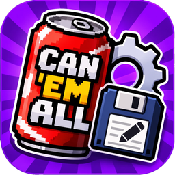
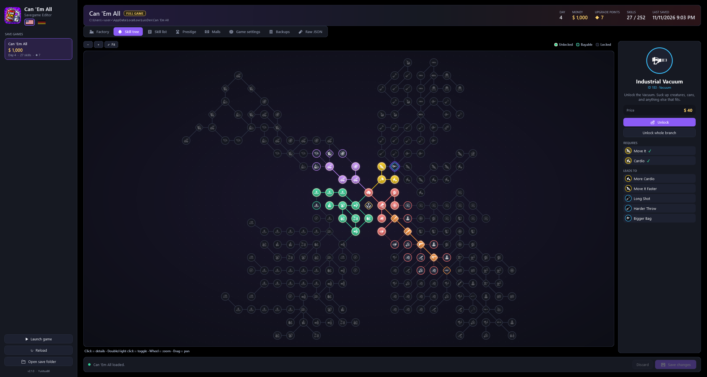
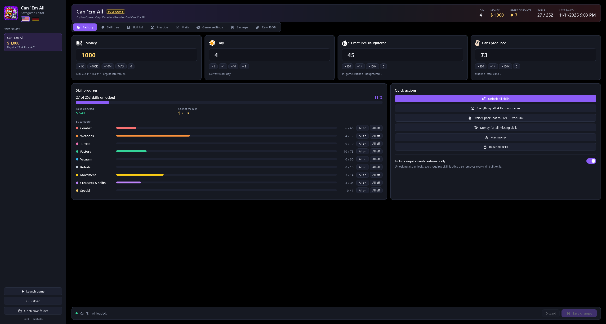
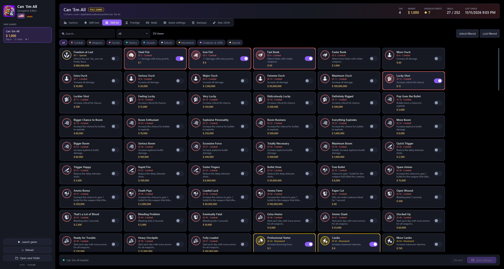
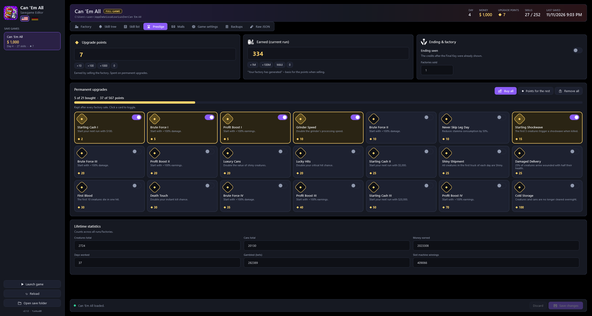
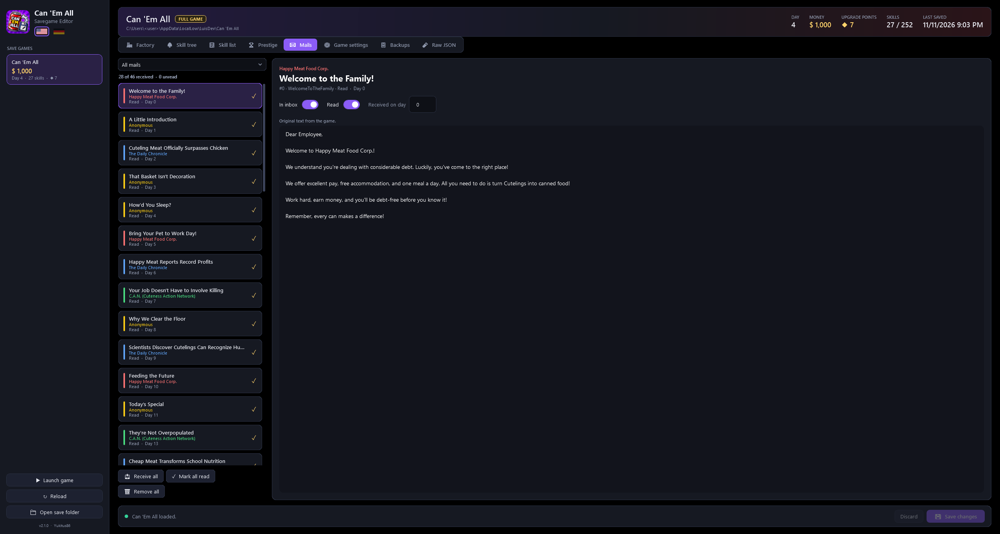
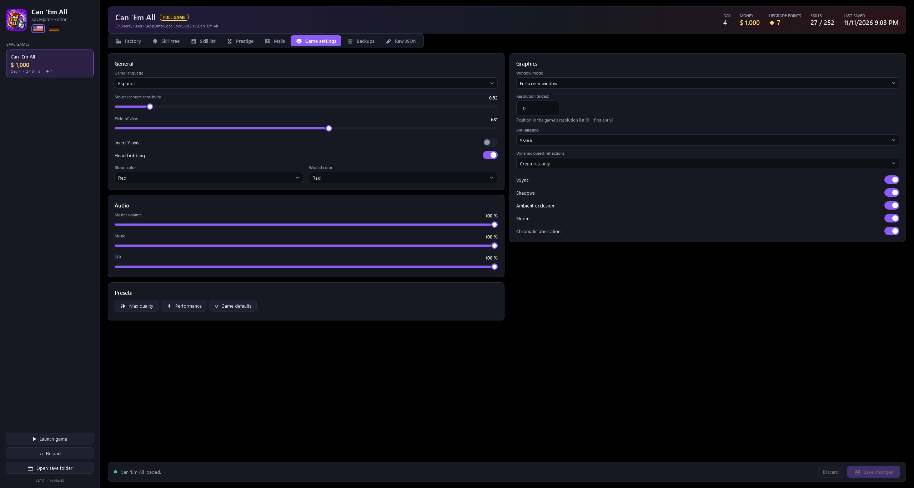
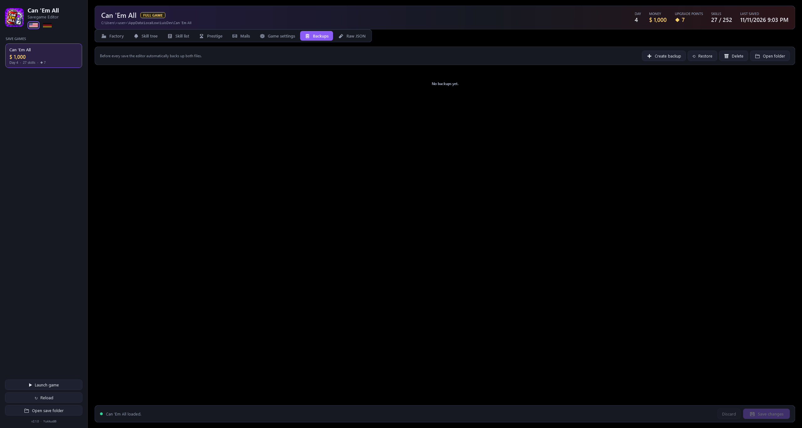

<p align="center">
  
</p>

<h1 align="center">Can 'Em All – Savegame Editor</h1>

<p align="center">
  Save editor for <b>Can 'Em All</b> (full game and demo, Steam, by LuisDev).<br>
  One exe, dark UI, English / German, automatic backups – the whole skill tree, prestige upgrades and story mails.
</p>

<p align="center">
  <a href="../../releases/latest"></a>
  <a href="../../releases"></a>
  
  <a href="LICENSE"></a>
</p>

<p align="center">
  <a href="../../releases/latest"><b>⬇ Download CanEmAllEditor.exe</b></a> · <a href="https://steamcommunity.com/sharedfiles/filedetails/?id=3838055041">Steam guide</a>
</p>

<p align="center">
  
</p>

Unofficial fan tool, not affiliated with LuisDev. The interface is in **English and German** – switch with the flags in the top left.

## Features

| Tab | What you can change |
|-----|---------------------|
| **Factory** | Money, day, creatures slaughtered, cans produced (quick buttons), skill progress per category with all on / all off, quick actions: unlock all skills, everything (skills + permanent upgrades), starter pack (bat to SMG + vacuum), money for all missing skills, max money, reset |
| **Skill tree** | All 252 skills (demo: 231) in the game's own tree layout with the game's icons. Zoom, pan, click for details, double or right click to toggle, unlock a whole branch |
| **Skill list** | Cards with search, category chips (combat, weapons, turrets, factory, vacuum, robots, movement, creatures & shifts, special) and a status filter; unlock or lock everything that is filtered |
| **Prestige** *(full game)* | Upgrade points, money earned this run, factories sold, "ending seen", all 21 permanent upgrades (click to buy or remove, buy all, points for the rest) and the lifetime statistics |
| **Mails** *(full game)* | All 46 story mails with their original text: receive, mark read, ACCEPT (slot machine offer, factory sale offer), received day |
| **Game settings** | `settings.sav`: language, mouse / camera sensitivity, field of view, invert Y, head bob, blood and wound color, volumes, window mode, resolution, VSync, anti-aliasing, shadows, reflections, AO, bloom, chromatic aberration, quality presets |
| **Backups** | Automatic backup of both files before every save, manual backup, restore, delete |
| **Raw JSON** | Edit `save.sav` / `settings.sav` directly, export and import |

| Factory | Skill list | Prestige |
|---------|------------|----------|
|  |  |  |

| Mails | Game settings | Backups |
|-------|---------------|---------|
|  |  |  |

Also:

- Full game and demo: the edition is detected from the save folder, each has its own skill data (prices, layout and requirements differ)
- Requirements are pulled in when you unlock a skill, and skills built on it are removed when you lock it, so the tree stays valid and `unlockedSkills` keeps a valid purchase order (can be switched off)
- Files are written in the exact Unity JsonUtility format: an unchanged save is written back byte for byte, floats stay `100.0`
- Saving is blocked while the game runs; a warning appears when the game wrote the file after the editor loaded it
- Single self-contained exe, no installation, no .NET runtime needed

## Usage

1. Download `CanEmAllEditor.exe` from the [latest release](../../releases/latest) (Windows 10/11 x64).
2. Close the game.
3. Start the editor, change what you want, click **Save changes**.

The editor looks for saves here:

```
Full game   %USERPROFILE%\AppData\LocalLow\LuisDev\Can 'Em All\save.sav, settings.sav
Demo        %USERPROFILE%\AppData\LocalLow\LuisDev\Can 'Em All Demo\save.sav, settings.sav
```

Backups go to `EditorBackups\` inside that folder.

Steam Cloud: if Steam puts an older save back after editing, start the game once, quit, then edit again – or switch Steam Cloud off for the game while you edit.

## Save format

Plain JSON written by Unity's `JsonUtility` (4-space indent, LF, no BOM). Full game:

| Field | Meaning |
|-------|---------|
| `money`, `day`, `totalKilled`, `totalCans` | Current run |
| `totalMoney` | Money earned this run ("Your factory has generated", basis for the points when selling) |
| `upgradePoints` | Points for permanent upgrades |
| `unlockedSkills` | Skill ids in purchase order |
| `unlockedPermanentUpgrades` | Permanent upgrade ids 232–252 |
| `mails` | `{ id, receivedDay, opened, accepted }`; `id` = `MailId` enum value, `receivedDay` keeps counting across runs |
| `lifetimeStats` | Creatures, cans, money earned, gambled, gambling winnings, days worked, factories sold |
| `hasSeenEnding` | Credits after the Final Key were shown |

Selling the factory resets money, day, run money and skills; permanent upgrades, points, mails and lifetime statistics stay.

## Build

Needs the .NET 10 SDK.

```
build.cmd
```

It publishes the single-file exe to `publish\`. Developer aids (use copies of your saves!):

- `--root <folder>` use another save folder
- `--lang de|en` start in that language
- `--snapshot <folder>` render every tab maximized to PNG and exit (`--mask-user` hides the user name in paths)
- `--selftest <log>` edit, save and verify the loaded save (full game: 25 checks, demo: 19)

## Game data

Skill ids, prices, requirements, tree positions and icons were extracted from the game's scene (`level0`, `SkillNode` + `Skill` components) and its `Translate` text asset: `Data/skills_full.json`, `Data/skills_demo.json`, `Assets/icons`. Permanent upgrades (`PermanentUpgrade` + skill components) are in `Data/permanent.json`; mail ids follow the game's `MailId` enum (from `global-metadata.dat`) and are in `Data/mails.json`.

## Layout

| Path | Purpose |
|------|---------|
| `src/CanEmAllEditor/Core/UnityJson.cs` | Reads and writes JsonUtility's format, keeps key order and unknown keys |
| `src/CanEmAllEditor/Core/SaveStore.cs` | Save folder detection, editions, backups |
| `src/CanEmAllEditor/Core/SkillData.cs`, `GameData.cs` | Skills, permanent upgrades, mails (embedded JSON) |
| `src/CanEmAllEditor/Core/Loc.cs` | English / German texts |
| `src/CanEmAllEditor/SkillTreeControl.cs` | Skill tree view |
| `src/CanEmAllEditor/MainWindow.xaml(.cs)`, `ViewModels.cs` | Window, tabs, saving |

See [CHANGELOG.md](CHANGELOG.md) for the version history.

## License

MIT, see [LICENSE](LICENSE).
